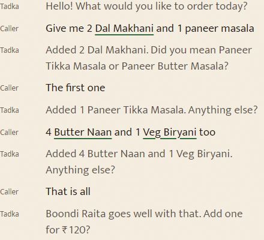
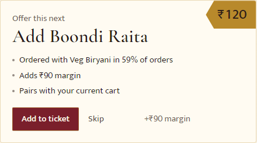
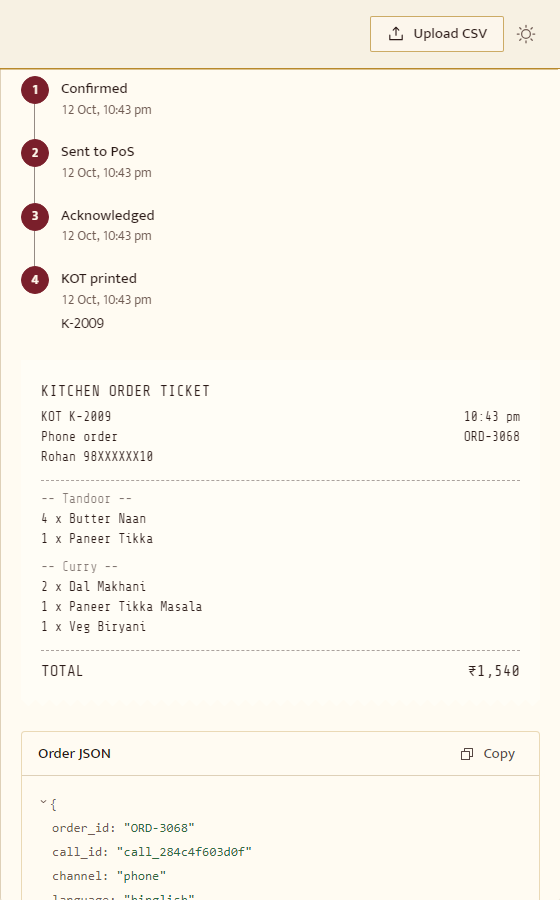

<div align="center">

# ❖ TADKA (तड़का)
### *AI-Powered Voice Copilot & Autonomous Revenue Engine for Restaurants*

[](https://fastapi.tiangolo.com/)
[](https://reactjs.org/)
[](https://www.typescriptlang.org/)
[](https://www.python.org/)
[](https://tailwindcss.com/)
[](https://github.com/Saumya2509/AI-Voice-Copilot)
[](LICENSE)

<p align="center">
  <b>Tadka</b> reads your restaurant's Point-of-Sale (PoS) history to uncover high-margin opportunities and hidden affinities, then acts on them live during customer phone calls — taking orders conversationally in <b>English</b>, <b>Hindi</b>, or <b>Hinglish</b>, pitching data-backed upsells, and dispatching kitchen-ready KOTs directly to the kitchen.
</p>

<p align="center">
  🔒 <b>100% Local & Privacy-Preserving</b> • ⚡ <b>Sub-Second Turnaround (~40ms)</b> • 💰 <b>Zero Third-Party Cloud LLM Costs</b>
</p>

---

</div>

## 🌟 At a Glance

| Pillar | Capability |
| :--- | :--- |
| **🗣️ Real-time Voice AI** | Natural, interruptible (full duplex barge-in) phone ordering with in-browser offline Vosk STT and Piper neural TTS. |
| **🌐 Native Code-Switching** | Fluent parsing of English, Hindi, and colloquial Hinglish (e.g., *"ek paneer butter masala, do butter naan, aur bas itna hi"*). |
| **📊 Revenue Optimization Engine** | Menu Engineering matrix (Stars, Plowhorses, Puzzles, Dogs), Apriori itemset mining, and automated price elasticity modeling. |
| **🎯 Dynamic Upsell Ranker** | Context-aware, margin-prioritized upsells and combos triggered at natural conversational boundaries. |
| **🖨️ Automated PoS & KOT** | Idempotent kitchen order ticket generation, POS push retry queue, and live SSE order desk synchronization. |
| **🏛️ Heritage Fine Dining UX** | Bespoke design system inspired by classic menu cards: Ivory paper (`#F7F1E3`), Maroon (`#7A1F2B`), and Antique Gold (`#B8892B`). |

---

## 📸 The Workflow in Action

<div align="center">
  <table>
    <tr>
      <td width="33%" align="center">
        <b>Step I: Voice Desk & Real-time Intake</b><br/><br/>
        
        <br/>
        <sub>Live multilingual transcription, English gloss, and caller barge-in.</sub>
      </td>
      <td width="33%" align="center">
        <b>Step II: Data-Driven Upsell & Combos</b><br/><br/>
        
        <br/>
        <sub>High-margin pairing suggestions powered by historical ticket affinities.</sub>
      </td>
      <td width="33%" align="center">
        <b>Step III: Instant KOT & PoS Dispatch</b><br/><br/>
        
        <br/>
        <sub>Automated kitchen ticket printing with sequential numbering and retry guarantees.</sub>
      </td>
    </tr>
  </table>
</div>

---

## 🏛️ System Architecture

```mermaid
flowchart TD
    subgraph Client ["Client Browser (React + Vite)"]
        MIC["Microphone Audio"] --> VOSK["Vosk STT (Web Worker / WASM)"]
        VOSK --> WS_C["WebSocket Client"]
        WS_C --> CALL_DESK["Call Desk UI & Live Ticket"]
        TTS_OUT["Piper Audio Player / Web Speech"] <-- WS_C
    end

    subgraph Server ["Backend Core (FastAPI)"]
        WS_S["WebSocket Endpoint (/ws/call/{id})"] <--> WS_C
        
        subgraph NLU_Layer ["NLU & Dialogue Pipeline"]
            NORM["Normalizer & Lexicon Matcher"]
            PHONETIC["Phonetic & Alias Matcher"]
            INTENT["Intent Classifier (scikit-learn)"]
            GLOSS["English Gloss Generator"]
            DM["Dialogue Manager & Cart State"]
        end
        
        WS_S --> NORM --> PHONETIC --> INTENT --> DM
        NORM -.-> GLOSS -.-> WS_S

        subgraph Revenue_Engine ["Revenue & Optimization Engine"]
            APRIORI["Apriori Association Mining"]
            MENU_ENG["BCG Matrix (Stars / Plowhorses / Puzzles / Dogs)"]
            ELASTICITY["Price Elasticity Modeling"]
            UPSELL["Dynamic Upsell Ranker"]
        end

        DM <--> Revenue_Engine
        
        subgraph Audio_Synthesis ["Voice Engine"]
            PIPER["Piper Neural TTS (Local ONNX)"]
        end
        
        DM --> PIPER --> WS_S
        
        subgraph Storage_POS ["Data & Integration"]
            SQLITE[("SQLite (Tadka DB)")]
            POS_ADAPTER["PoS Adapter & KOT Dispatcher"]
            SSE_BUS["Live Server-Sent Events (/orders/stream)"]
        end

        DM --> SQLITE
        DM --> POS_ADAPTER
        POS_ADAPTER --> SSE_BUS
    end

    SSE_BUS -.-> CALL_DESK
```

---

## ⚡ Performance Benchmarks (Seed 42)

All benchmarks are measured running 100% on local hardware without cloud round-trips:

| Metric | Result | Benchmark Details |
| :--- | :--- | :--- |
| **Voice Item Accuracy** | **100%** | Tested across 84 canonical spoken ordering utterances |
| **Intent Accuracy** | **100%** | Evaluated on held-out test intents and edge variations |
| **English Gloss Alignment** | **95.2%** | Real-time Devanagari/Hinglish → English translation match |
| **Parser Latency (p95)** | **~5 ms** | Sub-millisecond rule evaluation & entity extraction |
| **Server Turn Latency (p95)**| **~40 ms** | End-to-end WebSocket turnaround (NLU + cart + dialogue) |
| **Apriori Mining Speed** | **0.25 s** | Fast mining across ~12,000 historical orders (vs. 14s FP-Growth) |
| **CSV Import Throughput** | **~2.5 s** | Instant ingestion of a 53,000-line historical sales CSV |
| **Live Order Dispatch** | **< 0.2 s** | Real-time SSE dispatch to client screens |

---

## 🚀 Quick Start

### Prerequisites
- **Python**: `3.11` or newer
- **Node.js**: `v18` or newer (with `npm`)
- **Make** *(optional, Windows users can use `python tasks.py`)*

### 1. Installation
Clone the repository and install dependencies (creates Python venv, downloads speech models, builds shared types):

```bash
git clone https://github.com/Saumya2509/AI-Voice-Copilot.git
cd AI-Voice-Copilot

# Using Make (Linux/macOS):
make install

# On Windows (PowerShell / CMD):
python tasks.py install
```

### 2. Launch Development Environment
Starts the FastAPI server on port `8000` and Vite web app on port `5173`:

```bash
# Using Make:
make dev

# On Windows:
python tasks.py dev
```
Open **[http://localhost:5173](http://localhost:5173)** in your browser.

### 3. Interactive CLI Simulation
Test the dialogue manager and voice flow straight from your terminal:

```bash
# Run the three sample scenarios (Hinglish, Hindi, English)
python tasks.py simulate

# Or supply custom lines separated by '|':
python tasks.py simulate --say "ek paneer butter masala|do butter naan|aur kuch meetha hai?|bas itna hi"
```

---

## 🛠️ Developer Tooling & Commands

| Task | Command | Description |
| :--- | :--- | :--- |
| **Install** | `make install` *(or `python tasks.py install`)* | Sets up virtual environment, npm packages, downloads Vosk and Piper models |
| **Dev Server** | `make dev` *(or `python tasks.py dev`)* | Launches API (:8000) and Web App (:5173) concurrently |
| **Run Tests** | `make test` *(or `python tasks.py test`)* | Executes pytest API contract suite, vitest suite, and TypeScript check |
| **Voice Eval** | `make eval` *(or `python tasks.py eval`)* | Runs the 84-utterance voice test suite (measures item & intent accuracy, latency) |
| **Retrain** | `make train` *(or `python tasks.py train`)* | Re-indexes menu items, aliases, and retrains the scikit-learn intent classifier |
| **Simulate** | `make simulate` *(or `python tasks.py simulate`)* | Replays scripted multi-turn conversations in terminal |
| **UI Capture** | `make shots` *(or `python tasks.py shots`)* | Automated screenshots across desktop (1440px) & mobile (390px) in light/dark |
| **Acceptance** | `npm run test:ui` *(in `apps/web`)* | Full headless browser verification of UX criteria |

---

## 🧠 Key Innovations & Engineering Decisions

<details>
<summary><b>1. Natural Voice Engine & Barge-In (Full Duplex)</b></summary>
<br/>

- **Full-Duplex Interruption**: The microphone remains open while the agent speaks. If the customer interrupts (*"nahi, ek kaam karo paneer tikka cancel karo"*), the synthesis halts instantly (`ui.barge_in`), switching to active listening.
- **Echo Cancellation & Self-Speech Filtering**: Browser acoustic echo cancellation paired with lexical filtering prevents the agent from mistaking its own speaker audio for the caller.
- **Local Neural Voices**: Speech is synthesized using local Piper neural ONNX models (`en_US-lessac-medium` and `hi_IN-priyamvada-medium`). Latency is ~300ms on first run with zero-delay cache for common dialogue steps.
- **Dual Phonetic Transcripts**: Hinglish text is phonetically mapped into Devanagari representations so the Hindi neural voice pronounces dishes and modifiers with natural inflection.
</details>

<details>
<summary><b>2. Revenue Optimization & Menu Engineering</b></summary>
<br/>

- **BCG Menu Matrix**: Classifies all menu items into **Stars** (high volume, high margin), **Plowhorses** (high volume, low margin), **Puzzles** (low volume, high margin), and **Dogs** (low volume, low margin).
- **Association Mining (Apriori)**: Leverages optimized apriori itemset mining to discover pairings with high conditional lift ($\ge 1.3$). Dogs are strictly pruned from upsell pools.
- **Dynamic Pricing Lab**: Calculates price elasticity from historical multi-price observation windows, recommending safe +3% to +5% micro-adjustments that respect category margin guardrails.
</details>

<details>
<summary><b>3. Lexicon & Resilient Multilingual NLU</b></summary>
<br/>

- **Menu-Biased Dual Recognition**: Concurrently evaluates open vocabulary and grammar-restricted vocabularies for maximum phonetic robustness.
- **Homophone Disambiguation**: Recognizes speech-to-text sound-alikes (e.g., *"to butter naan"* $\rightarrow$ 2 butter naan; *"for garlic naan"* $\rightarrow$ 4 garlic naan).
- **English Glossing**: Translates live customer Hindi/Hinglish speech into clean English display cards for the kitchen and front desk with 95%+ exact match fidelity.
</details>

<details>
<summary><b>4. Robust Point-of-Sale Integration</b></summary>
<br/>

- **Integer Paise Precision**: Financial math is stored in whole paise (`_paise`) across SQLite, avoiding floating-point inaccuracies.
- **Idempotency & Replay**: Calls and order state track strict sequence numbers (`seq`). Client reconnection replays unacknowledged events (`resume`).
- **Kitchen Order Ticket (KOT)**: Formats standard kitchen tickets with modifier flags, spice levels, customer channel, and POS status tracking.
</details>

---

## 🎨 Design System: Heritage Fine Dining

The visual language reflects the warmth and heritage of a classic grand Indian restaurant:

```
Palette
├─ Ivory Paper   : #F7F1E3 (Warm, laid-paper textured background)
├─ Royal Maroon  : #7A1F2B (Primary accents, hero frames, active tabs)
├─ Antique Gold  : #B8892B (Hairlines, ❖ ornaments, highlighted rules)
└─ Deep Charcoal : #1F1B18 (High-contrast, legible typography)

Typography
├─ Headings      : Cormorant Garamond (Lining numerals, classic elegance)
├─ UI & Body     : Mukta (Seamless Latin & Devanagari support)
└─ KOT Printer   : Share Tech Mono (Authentic thermal receipt output)
```

---

## 📁 Repository Structure

```
AI-Voice-Copilot/
├── apps/
│   ├── api/                     # FastAPI Backend Application
│   │   ├── dialogue/            # State machine & conversational templates
│   │   ├── nlu/                 # Normalizers, phonetic matcher, intent classifier
│   │   ├── pos/                 # POS adapters, KOT generator & retry queue
│   │   ├── revenue/             # Menu engineering, Apriori mining & pricing engine
│   │   ├── seed/                # Deterministic synthetic restaurant generator
│   │   └── upload.py            # Sales CSV validator & ingestion engine
│   └── web/                     # React + Vite Frontend Application
│       ├── src/features/        # Call desk, analytics, menu, pricing lab, upload
│       ├── src/components/      # KOT printed ticket, audio waveform, status bar
│       ├── src/lib/             # Offline Vosk worker, Piper client, WebSocket sync
│       └── scripts/             # Visual acceptance tests & screenshot generators
├── packages/
│   └── shared/                  # Universal JSON Schemas & TypeScript interfaces
├── data/
│   ├── lexicon/                 # Multi-language aliases, modifiers & phonetic gloss
│   ├── samples/                 # Sample sales data & scripted test calls
│   └── models/                  # Local Piper TTS ONNX models (git-ignored)
├── md/                          # Technical specifications (00 to 09 & improve.md)
├── tasks.py                     # Cross-platform automation tasks
└── Makefile                     # Developer command runner
```

---

## 📜 License & Acknowledgments

- **License**: Released under the [MIT License](LICENSE).
- **Speech Models**: Powered by [Vosk Browser](https://alphacephei.com/vosk/) and [Piper TTS](https://github.com/rhasspy/piper).
- **Dish Photography**: Freely licensed imagery from Wikimedia Commons (credits documented in `credits.json`).

<div align="center">
  <sub>Crafted with passion for restaurants, voice AI, and high-performance local engineering.</sub><br/>
  <b>❖ TADKA • तड़का</b>
</div>
